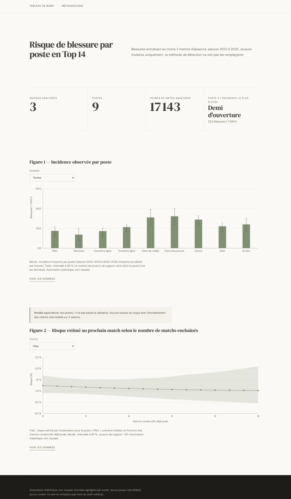

# Rugby Injury Risk — étude du risque de blessure par poste en Top 14

> **Statut : étude de data science, à vocation d'évoluer en outil prédictif de machine learning.**
> Le pipeline de bout en bout est en place (collecte, entrepôt, modèles, API, tableau de bord).
> Le pouvoir prédictif est volontairement présenté pour ce qu'il est : **faible** (voir
> [Résultats](#résultats-et-limites-honnêtes)). Le résultat solide est l'**incidence observée par
> poste** ; les modèles sont une piste exploratoire, aucun n'est promu.

Quelle est la probabilité de blessure d'un joueur de Top 14 à sa prochaine titularisation, selon son
**poste** et le nombre de **matchs enchaînés** ? La question est étudiée **par poste, jamais par
joueur** : la blessure est une donnée de santé (RGPD art. 9), le projet ne publie aucune donnée
nominative.



## Ce que ce projet démontre

| Compétence | Où le voir |
|---|---|
| **Data engineering** : collecte polie et rejouable, lac brut immuable, entrepôt en étoile | `src/rugby_risk/http/`, `parsers/`, `dbt/` (34 modèles), `orchestration/` (Dagster) |
| **Qualité des données** : résolution d'entités, tests dbt, quarantaine des enregistrements invalides, version de dataset par hash | `entity_resolution/`, `features/`, `dbt/tests/` |
| **Construction d'un label sans vérité terrain** : détection de blessures par signaux croisés (sorties précoces, absences) avec score de confiance | `injuries/`, `config/injury_rules.yaml` |
| **Anti-fuite temporelle** : features figées à `as_of_ts`, oracle Python indépendant, test de mutation | `features/`, `tests/integration/test_leakage.py` |
| **Modélisation** : baseline Poisson, hazard en temps discret, bayésien hiérarchique (PyMC), gradient boosting calibré (SHAP, ALE) | `src/rugby_risk/modeling/` |
| **Évaluation rigoureuse** : découpage par saison, calibration, Brier, bootstrap par joueur, diagnostics MCMC | `modeling/runner.py`, `metrics.py`, `validation.py` |
| **Esprit critique** : deux erreurs de méthode trouvées et corrigées, résultats négatifs publiés | [Ce que j'ai appris](#ce-que-jai-appris-des-erreurs) |
| **MLOps** : MLflow, artefacts versionnés, promotion humaine explicite, CI | `modeling/artifact.py`, `.github/workflows/` |
| **Mise en production** : API FastAPI en lecture seule, export agrégé k-anonyme, front Next.js | `api/`, `serving/`, `web/` |
| **Conformité** : minimisation, pseudonymisation HMAC, garde-fous testés | `privacy.py`, `serving/guard.py`, `docs/07-legal-rgpd.md` |

Volumétrie : ~11 800 lignes de Python, ~8 500 lignes de tests (464 tests), 34 modèles dbt, 53 000
lignes joueur-match, 1 034 joueurs, 3 saisons.

## Comment ça marche

```
 Sources publiques            Collecte                Stockage                  Modèles                Produit
 allrugby, LNR, ESPN,   →   httpx poli + robots  →  data/raw (immuable)   →   table ML figée      →   Export agrégé k>=10
 World Rugby, presse        cache, débit limité     Parquet staging            (hash de version)       API FastAPI (lecture seule)
                                                    DuckDB + dbt (étoile)      MLflow, PyMC, sklearn   Dashboard Next.js
```

Principe directeur : **chaque couche est rejouable**. On re-parse depuis le lac brut sans
re-scraper, on reconstruit l'entrepôt depuis le staging, on réentraîne depuis une table ML dont le
hash identifie la version.

### 1. Collecte
Client HTTP « poli » : autorisation par source vérifiée **avant** tout appel, limite de débit par
domaine, respect de `robots.txt`, cache conditionnel, retries bornés. Chaque réponse est écrite
telle quelle (`.zst`) dans un lac immuable avec son empreinte SHA-256.

### 2. Parsing et entrepôt
Les parseurs sont des fonctions pures `bytes → modèles Pydantic` ; une page inattendue part en
quarantaine au lieu de casser le pipeline. dbt-duckdb construit un schéma en étoile
(`staging → intermediate → marts → ml`) avec tests génériques et tests métier (somme des minutes,
15 titulaires).

### 3. Résolution d'entités
Un même joueur apparaît sous plusieurs graphies selon la source. Un rapprochement probabiliste
(Splink) avec revue humaine des cas incertains produit un identifiant unique, jamais exposé : seul
un **pseudonyme HMAC-SHA256** (`player_key`) circule dans la table d'apprentissage.

### 4. Construction du label (le point le plus difficile)
Aucune base publique de blessures du Top 14 n'existe. Une blessure est **reconstruite** :
un titulaire qui sort avant un seuil de minute propre à son poste, **puis** disparaît d'au moins
2 matchs. Chaque épisode reçoit un score de confiance (0,6 retenu). Résultat : 395 événements sur 3
saisons, avec une incidence détectée de 54 / 1 000 h (cohérente avec la littérature) et 18 / 1 000 h
au seuil retenu.

### 5. Table d'apprentissage sans fuite
Chaque feature est calculée **uniquement** à partir de ce qui était connu avant le coup d'envoi
(`as_of_ts`). Trois garde-fous : un oracle Python indépendant recalcule les features, un test de
mutation vérifie qu'une fuite volontaire est bien détectée, et un registre de colonnes interdites (identifiants, cible, exposition du match)
exclut les variables du match en cours des features.

### 6. Modèles
| Modèle | Idée |
|---|---|
| M0 | Taux de blessure par poste (la référence à battre) |
| M1 | Hazard en temps discret (régression cloglog) avec splines |
| M1w | M1 pondéré par probabilité de sélection (IPW) |
| M2 | **Hiérarchique bayésien** (PyMC) : poste → groupe → unité, effets joueur et équipe-saison |
| M3 | Gradient boosting calibré (isotone) avec SHAP et ALE |

### 7. Évaluation
Validation **par saison uniquement** (jamais de k-fold aléatoire), transformations apprises sur le
train, saison finale 2025-2026 gelée. Métriques : log-loss, Brier et Brier skill, AUC, **pente et
intercept de calibration**, intervalle de bootstrap par joueur, et diagnostics MCMC (R-hat, ESS,
divergences) qui invalident automatiquement un run.

### 8. Mise en production
Un export **k-anonyme** (cellules de moins de 10 joueurs supprimées, colonnes identifiantes
interdites, contrôle répété à chaque écriture) alimente une API FastAPI en lecture seule (clé
anonyme, middleware qui bloque toute réponse contenant un identifiant) et un tableau de bord
Next.js. **Aucun modèle n'est publié comme « promu »** : la promotion exige un fichier écrit par un
humain.

## Résultats et limites honnêtes

Test sur la saison 2024-2025 : 5 155 titularisations, 134 blessures.

| Modèle | Log-loss | AUC | Pente de calibration |
|---|---|---|---|
| M0 taux par poste (référence) | 0,1197 | 0,56 | 0,77 |
| M1 hazard | 0,1199 | 0,62 | 0,56 |
| M3 gradient boosting | 0,1223 | 0,60 | 0,32 |
| M2 hiérarchique avec IPW | 0,1210 | 0,62 | 0,52 |
| **M2 hiérarchique sans IPW** | **0,1160** | **0,65** | **0,88** |

- **L'incidence par poste est le résultat fiable** : stable d'une saison à l'autre, de 14 / 1 000 h
  (talonneur) à 32 / 1 000 h (demi d'ouverture), moyenne pondérée par les heures.
- **Le modèle prédit peu.** M2 sans IPW est le seul à battre la référence avec une calibration
  globale correcte, mais l'écart est **dans le bruit** (intervalles de Brier qui se recouvrent), sur
  un seul test et le meilleur de cinq modèles essayés.
- **Aucun effet de l'enchaînement des matchs n'est établi**, ni hausse ni baisse : les pentes ont
  des intervalles à 90 % qui contiennent 0. Ce n'est pas « pas d'effet », c'est « pas assez de
  données pour le voir ».
- **Le label n'est pas validé à la main** et ne voit que les titulaires sortis avant la 60e minute :
  remplaçants et blessures tardives sont absents.
- **Plafond des données** : sans GPS, charge d'entraînement ni dossier médical, la littérature
  plafonne autour de 0,60 à 0,70 d'AUC.

## Ce que j'ai appris des erreurs

Deux erreurs de méthode ont été trouvées par des vérifications systématiques et corrigées ; elles
sont documentées plutôt que cachées (`docs/10-implementation-status.md`, soucis S17 et S18).

1. **Fuite par l'exposition.** Un modèle libre sur les minutes jouées atteignait 0,90 d'AUC : un
   joueur blessé sort tôt, donc « peu de minutes = blessure ». Une alerte automatique (AUC > 0,75) l'a
   signalé ; l'exposition est désormais contrainte.
2. **Les minutes ne sont pas une exposition.** Même corrigé, aucune blessure n'apparaît au-delà de
   60 minutes, car le label exige une sortie précoce. Les modèles Poisson classiques (offset en
   minutes) étaient donc faux par construction, et le « gain » du boosting venait seulement de ce
   biais. Le périmètre est maintenant restreint aux titularisations, avec une référence juste.

## Feuille de route vers un outil prédictif

1. **Valider le label** : annoter à la main 300 à 500 épisodes pour mesurer précision et rappel.
2. **Plus de données récentes** (2 à 3 saisons) pour obtenir plusieurs tests au lieu d'un seul.
3. **Élargir le label** aux remplaçants et blessures tardives, avec une analyse de sensibilité.
4. **Données de charge** si un partenariat le permet (GPS, entraînement) : le vrai levier de
   progression, au-delà du modèle.
5. **Promotion** d'un modèle uniquement après validation humaine et calibration par groupe de postes.

## Utiliser le projet

```bash
git clone <repo> && cd rugby-injury-risk
cp .env.example .env            # clés ; PSEUDONYM_SALT obligatoire hors tests
make setup                      # uv installe Python 3.12 et les hooks
make check                      # ruff, mypy strict, pytest (couverture >= 80 %)

uv run rugby-risk train m2_hierarchical_noipw --config configs/experiments/m2_hierarchical.yaml
uv run rugby-risk fit-final m2_hierarchical_noipw --config configs/experiments/m2_hierarchical.yaml
uv run rugby-risk publish-public --mode dry-run     # tables agrégées -> reports/public_preview/
make api                        # API sur :8000 (/docs)

cd web && pnpm install && pnpm build && pnpm exec next start -p 3000
```

Le collecte réelle exige une autorisation explicite par source (`config/sources.yaml`) et des
accords vérifiés (voir `docs/07-legal-rgpd.md`).

## Stack

Python 3.12 · uv · Polars · DuckDB · dbt · Dagster · Splink · statsmodels · PyMC · scikit-learn ·
SHAP · MLflow · FastAPI · Next.js · TypeScript · Recharts · pytest · ruff · mypy strict.

## Documentation

| Fichier | Contenu |
|---|---|
| `docs/00-vision.md` | Problème, question précise, critères de succès |
| `docs/02-science-priors.md` | Littérature et chiffres de référence |
| `docs/03-architecture.md` | Architecture technique détaillée |
| `docs/04-data-model.md` | Schéma complet (dimensions, faits, table ML) |
| `docs/06-modeling.md` | Formulation, modèles, validation, métriques |
| `docs/07-legal-rgpd.md` | Cadre juridique, garde-fous |
| `docs/10-implementation-status.md` | État réel, soucis ouverts, résultats, décisions en attente |
| `features/ROADMAP.md` | Features, dépendances, statuts |
| `CLAUDE.md` | Règles de travail pour l'assistant de développement |

*Ce dépôt a été développé avec l'assistance de Claude Code ; les règles de méthode (`CLAUDE.md`) et
les décisions de périmètre, de conformité et de promotion sont celles de l'auteur.*
